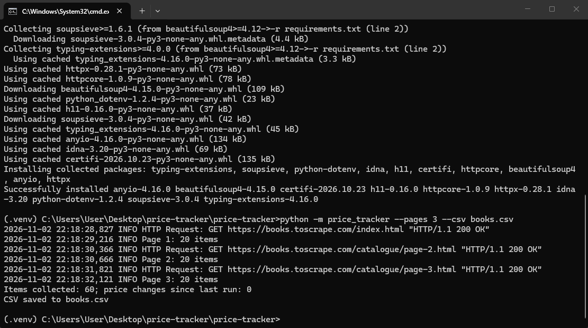

# Price Tracker

Консольный трекер цен на Python: обходит страницы каталога, сохраняет цены в SQLite, показывает, что подорожало или подешевело с прошлого запуска, выгружает данные в CSV и при желании шлёт уведомления о снижении цен в Telegram.

В примере используется [books.toscrape.com](https://books.toscrape.com/): это тренировочный сайт, созданный специально для практики парсинга. Тот же подход адаптируется под другие каталоги: нужно изменить селекторы в `price_tracker/parser.py`.



## Возможности

- Обход нескольких страниц по ссылке «next»
- Вежливый режим: один запрос за раз, пауза между страницами, повторы при сбоях, понятный `User-Agent`
- История цен в SQLite, точные суммы через `Decimal`, а не `float`
- Определение изменений цены между запусками
- Экспорт в CSV
- Уведомления в Telegram только о снижении цен
- Парсер не падает на странных блоках: проблемные карточки пропускаются с предупреждением в логе

## Стек

Python 3.11+, httpx, BeautifulSoup4, SQLite, python-dotenv, pytest

## Быстрый старт

```bash
git clone <ссылка-на-репозиторий>
cd price-tracker
python -m venv .venv
source .venv/bin/activate        # Windows: .venv\Scripts\activate
pip install -r requirements.txt
python -m price_tracker --pages 3 --csv books.csv
```

Запусти команду дважды: во второй раз программа покажет изменения цен (на тренировочном сайте цены не меняются, поэтому изменения можно проверить вручную, поправив цену в `prices.db`, или запустив тесты).

## Параметры

| Параметр | По умолчанию | Описание |
| --- | --- | --- |
| `--url` | главная books.toscrape.com | Стартовая страница каталога |
| `--pages` | 3 | Максимум страниц |
| `--delay` | 1.0 | Пауза между запросами, секунды |
| `--db` | `prices.db` | Файл SQLite |
| `--csv` | нет | Сохранить результат в CSV |
| `--notify` | выкл. | Отправить снижения цен в Telegram |

Для `--notify` создай `.env` по образцу `.env.example` и впиши токен бота и свой chat id.

## Как это устроено

```
price_tracker/
  cli.py       аргументы командной строки, сборка шагов
  fetcher.py   асинхронный обход страниц с повторами и паузами
  parser.py    разбор HTML (BeautifulSoup)
  storage.py   SQLite: текущие цены и история
  notify.py    сообщение о снижении цен и отправка в Telegram
  models.py    Item и PriceChange
tests/         pytest + HTML-примеры страниц, без обращения к сети
```

## Тесты

```bash
pip install -r requirements-dev.txt
pytest
```

Тесты работают без интернета: страницы подставляются из `tests/fixtures`.

## Этика и правила

Парсь только публичные данные и соблюдай `robots.txt` и условия использования сайта. Не используй трекер для обхода защиты или сбора персональных данных. Оставляй паузы между запросами.

## Что можно доработать

- Поддержка других сайтов через конфиг селекторов
- Запуск по расписанию (cron, systemd timer, GitHub Actions)
- Графики истории цен
- Отправка в Google Sheets

## Контакты

Принимаю заказы на парсеры, ботов и интеграции с API. Контакты: Telegram @welldonechief .

## Лицензия

MIT
